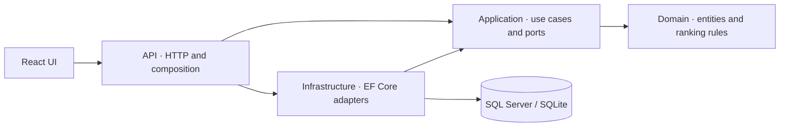

# Wayfinder · Carrier Recommendation Platform

A full-stack carrier discovery demo built with **ASP.NET Core / C#**, **EF Core**, **SQL Server**, and **React / TypeScript**. Shippers describe a shipment, discover eligible carriers, inspect an explainable quality score, and save a browser-local shortlist.

The project interprets a carrier search and recommendation interview summary as a product brief. All carriers, DOT labels, rates, and performance records are fictional. No historical performance improvement or business adoption result is claimed.

## What works

- Filter by exact origin/destination service lane, equipment, shipment weight, inclusive pickup availability, and optional USD-per-mile ceiling.
- Rank **all eligible carriers before pagination** using on-time delivery, safety, and capped experience; inspect the score breakdown.
- Search carrier names or demo DOT numbers; sort by match, rate, or name; page through results.
- Save and remove carriers in a browser-local shortlist that survives refreshes.
- Handle validation failures, service errors, empty results, loading, and unavailable browser storage.
- Run with SQLite for local development or SQL Server through Docker Compose.

## Quick start: SQLite demo

Prerequisites: [.NET 10 SDK](https://dotnet.microsoft.com/download/dotnet/10.0), [Node.js 22.12+](https://nodejs.org/), and [pnpm 10.20](https://pnpm.io/installation). No SQL Server or Docker is needed for this path.

From the repository root:

```sh
dotnet restore
dotnet run --project src/Carrier.Api
```

In another terminal:

```sh
cd web
pnpm install
pnpm dev
```

Open **http://127.0.0.1:5173**. The frontend forwards API requests to **http://localhost:5080**. The launch profile selects Development and creates a SQLite database with 24 fictional carriers and service lanes.

Availability windows are relative to the first seed date and last 90 days. To reset an old demo, stop the API, remove only its disposable `src/Carrier.Api/carriers.db` files, and restart. Production instances do not seed records or create schemas on startup.

## SQL Server demo with Docker

```sh
cp .env.example .env
# Edit .env and choose your local SQL Server password.
docker compose up --build
```

Open **http://localhost:8080**. The database and API are accessible only within the Compose network; only the frontend is published to loopback. The containers run an explicitly Development-only, fictional demo. SQL Server's container targets x86-64; on Apple Silicon use SQLite, or a supported external SQL Server instead of relying on emulation.

## Architecture



| Layer | Responsibility | Allowed project dependencies |
| --- | --- | --- |
| Domain | Carrier invariants, service lanes, quality ranking | None |
| Application | Discovery use case, validation, DTOs, repository port | Domain |
| Infrastructure | EF Core mapping, queries, sample data, SQL Server migrations | Application |
| API | HTTP contracts, dependency injection, error handling, request controls | Application, Infrastructure |
| Web | Accessible React interface and HTTP client | API contract |

Dependencies point inward. The API is the composition root; Infrastructure implements a port owned by Application. There is no EF Core, ASP.NET, or third-party package dependency in Domain or Application. See [architecture decisions](docs/architecture.md) for SOLID, KISS, DRY, separation of concerns, tradeoffs, and extensions.

## Recommendation rules

Eligibility is a hard constraint. An origin and destination must match **the same lane**; two separate lanes do not imply a route. Equipment must match exactly, capacity must cover the load, and the pickup date must fall within the carrier's inclusive availability window.

For eligible candidates:

```text
score = 50 × onTimeRate
      + 30 × safetyScore / 100
      + 20 × min(completedLoads / 500, 1)
```

The result is a 0–100 heuristic, not a calibrated probability. Rate is a filter or alternate sort, not part of the quality score. A carrier ID breaks ties. The domain expression determines database ordering and the same policy produces the explanation; tests verify their agreement. The API reports `quality-v1`, or `unranked` when ranking is disabled or a different sort is selected.

Set `Features__RankingEnabled=false` to roll ranked ordering back to alphabetical ordering while retaining eligibility checks.

## API

| Method | Route | Purpose |
| --- | --- | --- |
| GET | `/api/reference` | Supported demo cities/equipment and data notice |
| GET | `/api/carriers` | Optional filters, name/DOT search, stable paging |
| POST | `/api/recommendations` | Required shipment context and ranked discovery |
| GET | `/api/carriers/{id}` | Current carrier details, or 404 |
| GET | `/health/live` | Process liveness |
| GET | `/health/ready` | Database connectivity |

```sh
curl http://localhost:5080/api/carriers?pageSize=2
```

POST body example (choose a current UTC date within seeded availability):

```json
{
  "origin": "Chicago, IL",
  "destination": "Dallas, TX",
  "equipment": "dryVan",
  "pickupDate": "2026-11-09",
  "weightLb": 20000,
  "maxRatePerMile": 3,
  "query": "",
  "page": 1,
  "pageSize": 6,
  "sort": "recommended"
}
```

Equipment: `dryVan`, `refrigerated`, `flatbed`. Sort: `recommended`, `rate`, `name`. Pages are 1-based; page size is 1–50. Dates use UTC calendar days. Validation uses HTTP 400 Problem Details. Discovery routes have a per-IP limit of 120 requests/minute and return 429 on exhaustion. Errors include a trace ID without returning stack traces.

## Verification

```sh
dotnet build -c Release
dotnet run --project tests/Carrier.CoreChecks -c Release
dotnet test -c Release --filter 'Category!=SqlServer'
cd web
pnpm build
pnpm test
pnpm exec playwright install chromium
pnpm test:e2e
```

The dependency-free core runner checks business rules and project boundaries. xUnit covers real SQLite queries and HTTP behavior. Browser tests exercise discovery, score explanations, saving/removing carriers, persistence, empty states, and narrow layouts. GitHub Actions also runs a separate SQL Server translation test against a disposable database. See [testing and measurements](docs/testing.md) for exact scope and current verification evidence.

To run SQL Server tests, set `CARRIER_TEST_SQLSERVER` to an **empty disposable database** connection string, then run:

```sh
dotnet test tests/Carrier.Tests --filter 'Category=SqlServer'
```

The test creates tables and seeds fictional records; it does not delete an existing database. Do not point it at an application database.

## Schema changes and deployment

The included initial migration targets SQL Server. Apply migrations as a deployment step using a schema-owner connection; run the API with a lower-privilege connection. For example, set `Database__Provider=SqlServer` and `ConnectionStrings__Carriers` in your environment, then:

```sh
dotnet tool restore
dotnet ef database update --project src/Carrier.Infrastructure --startup-project src/Carrier.Api
```

Use migrations for a fresh SQL Server database; Development's `EnsureCreated` bootstrap is an alternative for disposable demos and cannot be mixed with migration history on that same database. SQLite is intentionally Development-only. For a deployed instance configure SQL Server, a trusted TLS connection, `AllowedHosts`, and frontend origins. Authentication/tenant authorization, live carrier feeds, booking, and verified availability are outside this demo's scope and must be designed before onboarding private shipper data.

## Project guide

- [Requirements and assumptions](docs/requirements.md)
- [Architecture decisions and query strategy](docs/architecture.md)
- [Test coverage and performance measurement](docs/testing.md)
- [API contract](docs/openapi.yaml)

The interview PDF is a requirements reference and is not redistributed in this repository.
